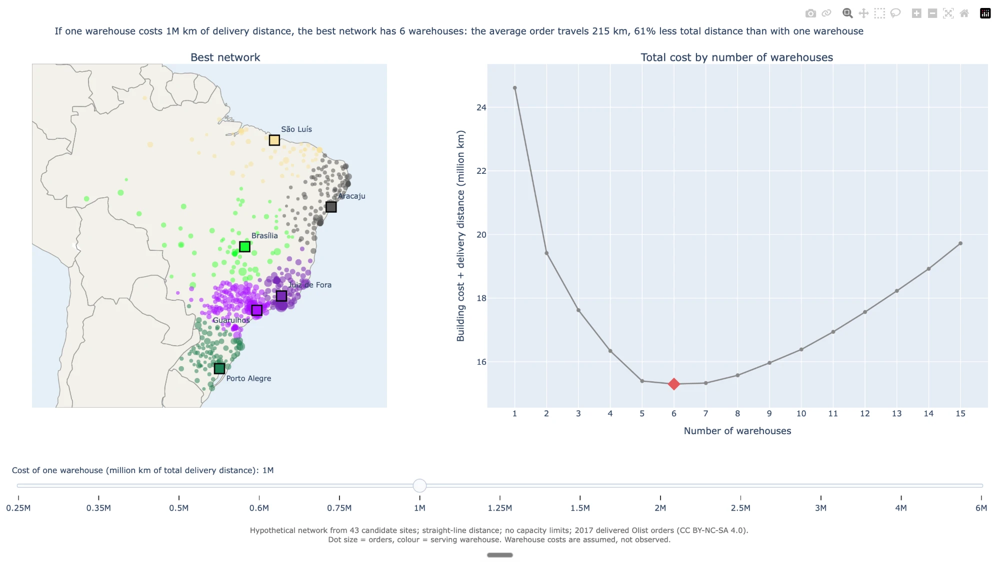

# Warehouse Network Optimization

Where should a distribution network put its warehouses, and how many are worth building? An integer programming model (Python, PuLP/CBC) solved on 43,314 Olist e-commerce orders from Brazil (2017).

**Start here:** [Project summary](docs/PROJECT_SUMMARY.md). To see the interactive map, open `outputs/figures/network_map.html` in a browser.



**Results** (modeled, hypothetical network, straight-line distance)
- 10 warehouses cut total delivery distance by 73% compared with one warehouse, and each extra warehouse helps less.
- The best number of warehouses depends on what a warehouse costs: about 10, 6, or 4 as costs rise.

**Run it** (developed and tested on Python 3.13; run these from the folder that contains the project)
```
cd warehouse-network-optimizer
python3 -m venv .venv
source .venv/bin/activate
pip install -r requirements-model.txt
python src/check_candidate_prototype.py
python src/try_model.py 4
python src/run_scenarios.py
python src/run_scenarios.py candidates_spaced50km.csv p_curve_spaced50km.csv
python src/break_even.py
python src/make_map.py
```
What each step does (on Windows, activate with `.venv\Scripts\activate`):
- `check_candidate_prototype.py`: quick check that the model matches a small example with known answers
- `try_model.py 4`: opens 4 warehouses and prints where (a few seconds)
- `run_scenarios.py`: 1 to 15 warehouses, first with all 81 candidate sites, then with the 43 spaced sites
- `break_even.py`: best number of warehouses by cost (a few minutes)
- `make_map.py`: builds the interactive map at `outputs/figures/network_map.html`

The model inputs are already in `data/processed/model_inputs/`, so the raw Olist files are not needed to run any of the above.

**Data and license:** data from the [Olist Brazilian E-Commerce Public Dataset](https://www.kaggle.com/datasets/olistbr/brazilian-ecommerce) (Kaggle), licensed [CC BY-NC-SA 4.0](https://creativecommons.org/licenses/by-nc-sa/4.0/). Raw data is not included. The derived tables, results and map (filtered to 2017 delivered orders and aggregated by state, city or ZIP3; no customer-level rows) are shared under the same license, with credit to Olist. The code in `src/` and `sql/` is under the MIT License (see `LICENSE`); the MIT License does not cover the data or outputs.
